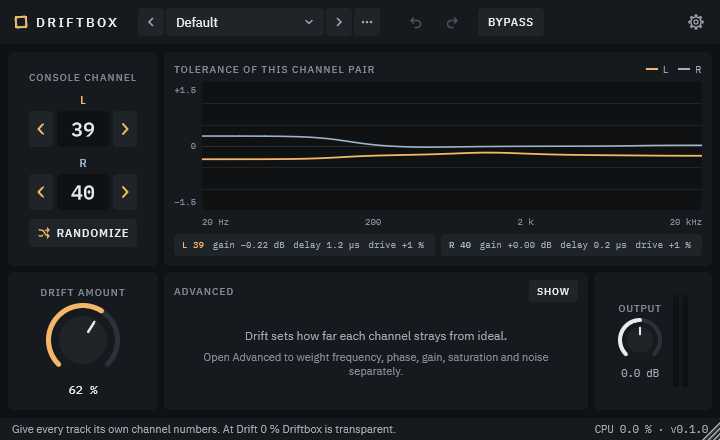

# Driftbox

Driftbox gives each side of a stereo track, left (L) and right (R), its own "console channel" from 1 to 64. Each channel is a fixed set of tiny component tolerances: a slightly different frequency response, phase/delay, gain, soft saturation and noise. Identical channels therefore stop sounding identical, which adds a little width and depth without any obvious effect. The algorithm is original; Driftbox does not emulate any commercial product.

Formats: VST3 and CLAP on Windows, macOS and Linux, plus AU on macOS. Mono and stereo tracks, zero latency.



## Tolerance modeling in plain words

Real analogue channels are never identical. The resistors and capacitors inside them are only accurate to within a small percentage, so two channels built from the same design differ a little: one is a fraction of a dB louder, one is slightly brighter, one lets the signal through a few millionths of a second later. Those small differences are inaudible one by one, but across a mix they add width and depth that perfectly identical digital channels lack.

Driftbox puts that behaviour on a track. Each console channel number stands for one fixed set of deviations, and the plugin applies the one chosen for L to the left signal and the one chosen for R to the right signal.

- **Drift Amount** scales everything. At 0 % Driftbox does not alter the signal (see below); at 100 % the channels deviate by the full amounts listed in the tolerance table.
- **Channel numbers** are deterministic: the same number gives the same sound in every project, on every computer and on every operating system. Changing a number during playback crossfades over 250 ms, so there are no clicks.
- **Randomize** picks a new L/R pair of channels. It is one undo step.
- **Suggested workflow**: give each track its own pair of channel numbers (for example 1 and 2 on the first track, 3 and 4 on the next), then raise Drift Amount until the mix opens up. Keep it subtle.

At Drift 0 % with Output at 0 dB the tolerance chain is an exact identity, so the signal is unchanged bit for bit. The one exception is the safety ceiling (see Parameters), which is always active: peaks above -1 dBFS are still softly limited.

## Parameters

| Parameter | ID | Range | Default | What it does |
|---|---|---|---|---|
| Channel L | `chanL` | 1 to 64 (integer) | 1 | Console channel applied to the left side. |
| Channel R | `chanR` | 1 to 64 (integer) | 2 | Console channel applied to the right side. |
| Drift Amount | `drift` | 0 to 100 % | 50 % | How far every channel strays from ideal. Scales all the weights below. |
| Frequency Tolerance (Freq) | `freqTol` | 0 to 100 % | 50 % | Weight of the shelf and bell deviations. |
| Phase Tolerance (Phase) | `phaseTol` | 0 to 100 % | 50 % | Weight of the tiny delay between channels. |
| Gain Tolerance (Gain) | `gainTol` | 0 to 100 % | 50 % | Weight of the level difference between channels. |
| Saturation | `saturation` | 0 to 100 % | 20 % | How much each channel softly saturates (scaled by Drift). |
| Noise | `noise` | 0 to 100 % | 0 % | Very quiet console hiss (scaled by Drift). |
| Output Gain | `outGain` | -24 to +24 dB, 0.1 dB steps | 0 dB | Gain after the drift chain. |
| Bypass | `bypass` | off / on | off | Bypasses the plugin with a 20 ms crossfade. No latency is added in either state. |

The five weights from Freq to Noise sit in the Advanced panel (SHOW / HIDE button); whether the panel is open is saved with the project. All parameters can be automated, and channel changes are click-free.

**Safety ceiling.** After the Output Gain the signal passes a soft limiter without latency: it leaves everything below -1 dBFS untouched, applies a soft knee above it, and never exceeds 0 dBFS. Non-finite input samples (NaN, Inf) are replaced with silence.

## Tolerances

The deviation of a channel is its fixed value (different for each channel number) times Drift Amount, times the matching tolerance weight, times the maximum below. The table lists those maxima, reached with Drift Amount at 100 % and the weight at 100 %, as defined in `src/dsp/DriftProfile.h` and applied in `src/dsp/DriftChannel.cpp`.

| Stage | Weight | Maximum deviation |
|---|---|---|
| Low shelf | Freq | up to +/-1 dB, centred near 150 Hz, centre moved by up to +/-1/2 octave |
| High shelf | Freq | up to +/-1 dB, centred near 8 kHz, centre moved by up to +/-1/2 octave |
| Bell | Freq | up to +/-0.75 dB, centre between 400 Hz and 3 kHz, Q 0.7 |
| Delay | Phase | up to 5 microseconds, always a delay (never an advance), as a first-order allpass |
| Gain | Gain | up to +/-1 dB |
| Saturation | Saturation | soft `tanh` saturation with drive 1 + Saturation x Drift, varied by up to +/-15 % between channels |
| Noise | Noise | about -84 dBFS RMS with Drift and Noise both at 100 %, +/-1.5 dB between channels, low-passed at about 12 kHz |

The graph in the editor shows the resulting frequency response of the current channel pair on a +/-1.5 dB scale.

**Note on peaks.** The phase stage is a first-order allpass, so it can raise the sample peak of full-band uniform white noise: a test signal peaking at about -6 dBFS can reach about 0.99 and touch the ceiling. Real program material and Gaussian noise keep their peak. The output never exceeds 0 dBFS.

## Presets

The preset bar has previous/next arrows and a list. Factory presets:

| Preset | Description |
|---|---|
| Init | Drift 0 %: the transparent starting point. |
| Subtle Spread | Drift 62 % with default weights: a gentle, general-purpose spread. |
| Wide Pair | Drift 85 % with stronger frequency and especially phase weights and low saturation: a wider stereo image. |
| Warm Console | Drift 70 % with moderate saturation and a little noise. |
| Gentle Grit | Drift 55 % with strong saturation, smaller frequency and phase weights and a trace of noise. |
| Noisy Desk | Drift 80 % with clearly audible console noise. |

User presets are `.dbp` files (small XML files) in the user preset folder: `%APPDATA%\Driftbox\Presets` on Windows, `~/Library/Application Support/Driftbox/Presets` on macOS, `~/.config/Driftbox/Presets` on Linux, or any folder you choose in Settings. Save, Save As and Delete are in the preset actions menu (the "..." button).

A preset stores Drift Amount, the three tolerance weights, Saturation, Noise and Output Gain. It does **not** store the L/R channels, Bypass or the Advanced panel state, so loading a preset never changes which channels a track uses. Loading a preset is one undo step, and the bar marks the preset as modified when the parameters differ from it.

## Settings

The gear button opens the Settings panel. Settings belong to you, not to the project or the presets, and are shared by every instance:

- **Zoom**: window size, 75 %, 100 %, 125 %, 150 % or 200 %.
- **Tooltips**: short help when hovering a control.
- **Show CPU**: CPU load of the instance in the footer.
- **User preset folder**: where `.dbp` presets are read and saved.
- **Updates**: automatic update check and a "Check now" button (see below).
- **Copy debug info**: copies the plugin version, format, host, OS, sample rate and block size to the clipboard, for bug reports.
- **Reset settings**: restores every setting to its default.

## Update check (privacy)

On Windows and macOS Driftbox looks for a newer version. This is **enabled by default**:

- at most once a day (when an editor is opened), plus whenever you press "Check now";
- one HTTPS GET to the public GitHub releases list of this repository (`https://api.github.com/repos/ivanerricis/driftbox/releases`), with no query string, no body and a single header, `User-Agent: Driftbox/<version>`;
- no personal data and no telemetry: nothing about you, your machine, your projects or your audio is sent;
- pre-releases are included, so an early tester is told about newer pre-releases and releases;
- the plugin only tells you that a newer version exists and can open its release page in your browser; it never downloads or installs anything.

To disable it, turn off "Check for updates" in Settings; nothing is then sent unless you press "Check now". On Linux the update check is not available.

## Installation

Download the files from [GitHub Releases](https://github.com/ivanerricis/driftbox/releases). Early versions are pre-releases (`rc`) and are not marked as "latest".

**Windows**
- `Driftbox-vX.Y.Z-windows-setup.exe`: run it (administrator rights are required) and choose VST3 and/or CLAP. The installer is unsigned, so SmartScreen may warn: choose More info, then Run anyway. VST3 goes to `C:\Program Files\Common Files\VST3\Driftbox.vst3`, CLAP to `C:\Program Files\Common Files\CLAP`. Uninstall from Apps and features.
- `Driftbox-vX.Y.Z-windows.zip`: copy `Driftbox.vst3` and `Driftbox.clap` to the folders above.

**macOS**
- `Driftbox-vX.Y.Z-macos.pkg`: installs VST3, CLAP and AU (selectable) system-wide into `/Library/Audio/Plug-Ins`. The installer is not Apple-signed; [docs/MACOS_SIGNING.md](docs/MACOS_SIGNING.md) explains how to open it past Gatekeeper.
- `Driftbox-vX.Y.Z-macos.zip`: copy the bundles to `~/Library/Audio/Plug-Ins/VST3`, `~/Library/Audio/Plug-Ins/Components` (AU) and `~/Library/Audio/Plug-Ins/CLAP`, then clear the quarantine flag as described in the same document.

**Linux**
- `Driftbox-vX.Y.Z-linux.tar.gz`: copy `Driftbox.vst3` to `~/.vst3` and `Driftbox.clap` to `~/.clap`.

Rescan plugins in your host afterwards.

## Verify downloads

Each release has a `SHA256SUMS.txt`. Put it in the same folder as the files you downloaded and run:

```
# Windows (PowerShell): compare the printed hash with the matching line in SHA256SUMS.txt
(Get-FileHash .\Driftbox-vX.Y.Z-windows.zip -Algorithm SHA256).Hash

# Windows (cmd or PowerShell)
certutil -hashfile Driftbox-vX.Y.Z-windows.zip SHA256

# macOS
shasum -a 256 -c SHA256SUMS.txt --ignore-missing

# Linux
sha256sum -c SHA256SUMS.txt --ignore-missing
```

`--ignore-missing` lets you check only the files you downloaded.

## Building from source

Requirements: CMake 3.25 or newer, a C++20 compiler (Visual Studio on Windows, Xcode on macOS, GCC or Clang on Linux) and Git. Dependencies are fetched by CPM at configure time and pinned in `cmake/Dependencies.cmake`: JUCE 8.0.15, clap-juce-extensions (pinned commit) and Catch2 v3.16.1 (tests only). Set `CPM_SOURCE_CACHE` to share downloads between builds.

```
cmake --preset win-vs            # win-ninja (Windows), mac-universal (macOS), linux
cmake --build --preset win-vs-release
ctest --preset win-vs-release
```

On macOS and Linux the configure, build and test presets share one name (`mac-universal`, `linux`). See [docs/DEVELOPMENT.md](docs/DEVELOPMENT.md) for validation, formatting and packaging, and [docs/ARCHITECTURE.md](docs/ARCHITECTURE.md) for the design.

## Testing in a DAW

A short checklist for VST3 and CLAP:

1. The plugin scans and loads, and the editor opens and closes cleanly.
2. Null test: with Drift Amount at 0 % and Output at 0 dB the output is identical to the input (peaks above -1 dBFS aside, because of the safety ceiling). Compare with Bypass on.
3. Change the channel numbers during playback: no clicks.
4. Save the project and reopen it: it sounds identical.
5. Automate Drift Amount, the channels and Bypass.
6. Open many instances and watch the CPU load.
7. Run [pluginval](https://github.com/Tracktion/pluginval) at strictness 10 (`scripts/dev/run-pluginval.ps1` on Windows).

## License

Driftbox is free software under the [GNU Affero General Public License v3.0 or later](LICENSE). The complete corresponding source code is in this repository; whoever distributes Driftbox binaries must make the corresponding source available under the same licence. Third-party components and their licences are listed in [THIRD_PARTY_NOTICES.md](THIRD_PARTY_NOTICES.md). See [CONTRIBUTING.md](CONTRIBUTING.md) to contribute and [CHANGELOG.md](CHANGELOG.md) for the history.
